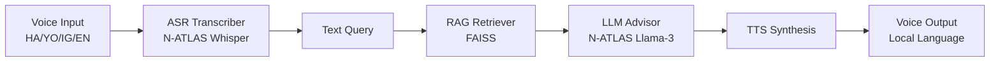

# 🌱 AgriVoice 
**Voice-First Agricultural Advisor for Nigerian Farmers**

## Problem Statement
Over 70% of Nigerian smallholder farmers lack access to agricultural extension services. They face language barriers, low literacy rates, and lack of timely advice on pests, diseases, and best practices.

## Solution
AgriVoice is a voice-first, AI-powered agricultural advisor accessible via web or WhatsApp. Farmers can simply record a voice note in Hausa, Yoruba, Igbo, or Nigerian-Accented English. AgriVoice transcribes it, retrieves relevant local agricultural knowledge (RAG), and responds with a helpful voice message in the same language. 

## Architecture

## Setup Instructions
1. Clone the repository
2. Install dependencies: `pip install -r requirements.txt`
3. Set your HuggingFace Token in `.env` (copy from `.env.example`)
4. Build the knowledge base index: `python -m app.rag.indexer`
5. Run the server: `python -m app.main`
6. Open `http://localhost:8000` to access the web demo.

## Technologies Used
* **NCAIR1/N-ATLaS**: Fine-tuned Llama-3 8B model for Nigerian languages (LLM)
* **ASR Models**: NCAIR1/Hausa-ASR, Yoruba-ASR, Igbo-ASR, NigerianAccentedEnglish
* **RAG**: Sentence-Transformers + FAISS
* **TTS**: gTTS for local language synthesis
* **Backend**: FastAPI, Gradio

*Credits to NCAIR/NITDA and Awarri for providing the N-ATLAS models.*
